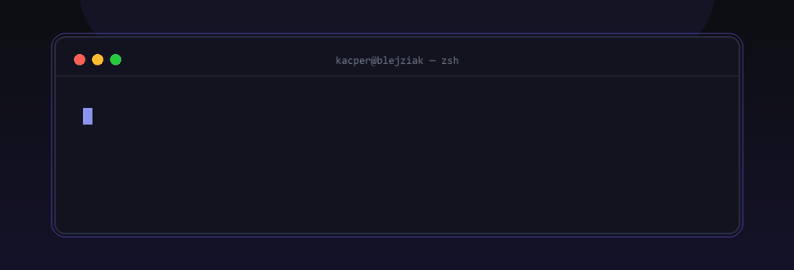

<kbd><a href="https://github.com/Blejziak">GitHub</a></kbd> · <kbd><a href="https://discord.com/users/TWOJE_ID">Discord</a></kbd> · <kbd><a href="mailto:kacper@example.com">E-mail</a></kbd>

Cześć, tu **Kacper** 👋

Robię boty do Discorda, klepię strony i ogarniam automatyzacje. Używam Javy, Node.js i Pythona — zależnie od tego, co ma być zrobione.

A jak nie kodzę, to łap mnie na Discordzie albo napisz maila.

**Stack:** `Java` `JavaScript/TypeScript` `Python` `Node.js` `React` `Tailwind`

<!--
  DO PODMIENIENIA (tylko 2 rzeczy):
  - https://discord.com/users/TWOJE_ID → Twój profil na Discordzie
    (ID: Discord → Ustawienia → Zaawansowane → Tryb programisty → Kopiuj ID użytkownika)
  - kacper@example.com → Twój e-mail (albo usuń fragment <kbd>...</kbd> z E-mail)

  Wszystko inne (statystyki, streak) ładuje się z internetu.
  ⚠️ BANER (assets/promo/banner.gif) MUSI być wrzucony do repo razem z README,
  inaczej się nie pokaże! (Add file → Upload files → cały folder assets)

  Chcesz zmienić teksty w banerze? Edytuj gen_banner.py (linie L1/L2/L3 na końcu)
  i uruchom: python gen_banner.py
-->
